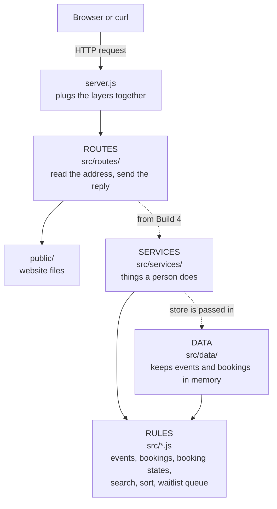

# Architecture (Build 3)

This page shows how the project is organised: what each part is for, which part may talk to which, and what happens when a request arrives.

## What the system must do

Taken from `docs/user-stories.md`.

**Features (what people can do)**
- An organizer creates an event with title, city, venue and date (S02), adds ticket tiers (S03), and publishes or unpublishes it (S04).
- An attendee searches, filters and sorts published events (S05), and books tickets (S06).
- A booking has a life cycle: pending, then paid, cancelled, expired or refunded (see `docs/booking-states.md`).
- The server answers `/health` and serves the website files in `public/`.

**Qualities (how it must behave)**
- Money is a whole number of cents. Never decimals.
- Search and sort never change the original list.
- Every error has the same shape: `{ "error": { "code": "...", "message": "..." } }`.
- The server only ever serves files from the `public/` folder.
- No outside packages. Only Node's built-in tools.

## The four layers

Each layer has one job. A layer may only use the layers listed in the last column.

| Layer | Folder | Its job | May import |
|---|---|---|---|
| **Routes** | `src/routes/` | Read the address and method. Send the reply. No business rules, no storage. | routes |
| **Services** | `src/services/` | One function per thing a person does, like "book" or "publish". | rules |
| **Rules** | `src/*.js` | The business rules: events, bookings, booking states, search, sort, the waitlist queue. | rules |
| **Data** | `src/data/` | Keeps things. Right now in memory. | rules |

`src/server.js` is not a layer. It only plugs the layers together. `start.js` starts it.

## Diagram

A solid arrow means "uses it now". A dotted arrow means "uses it, but not directly" or "is built later".

A picture of this diagram is also saved as `docs/architecture.png`, in case your editor does not draw Mermaid.

## What happens when a request arrives

Example: `GET /health`

1. The browser sends the request to the server.
2. `server.js` hands it to the router in `src/routes/index.js`.
3. The router checks the method. Only GET and HEAD are allowed. Anything else gets a 405.
4. The address is `/health`, so `src/routes/health.js` answers `200 {"status":"ok"}`.

Any other address goes to `src/routes/static.js`. It turns the address into a file path, checks the path is still inside `public/`, and sends the file. If there is no such file, the reply is a 404 in the standard error shape.

## What exists now, and what comes later

| Part | Build 3 (now) | Later |
|---|---|---|
| Routes | `/health` and static files | Build 4: the REST API calls the services |
| Services | Event and booking services, tested | Build 4: routes call them |
| Rules | Complete for events, bookings, search, sort, states | Build 8: refund amount, waitlist offers, expiry |
| Data | In memory | Build 5: SQLite |

## Decisions and shortcuts

- **The rules files stay in `src/`.** I did not move the Build 1 and 2 files into a `rules/` folder. Moving them would break the imports and the tests for no gain. The rule is "every file directly in `src/` is a rules file".
- **The store is passed in.** Services receive the store as a parameter instead of importing it. That keeps services free of storage details, and every test gets a fresh, empty store.
- **A known shortcut.** `BookingBook` (a rules file) still keeps its own `Map` of bookings. Build 5 moves that into the data layer when SQLite arrives.
- **No framework.** The server uses Node's built-in `http` module, because the project allows no outside packages.

## How the layering is protected

`test/architecture.test.js` reads every file in `src/`, looks at what it imports, and fails if a layer imports something it should not. It also fails if any file imports an outside package. The test also proves its own checker works, by feeding it deliberately bad examples.
